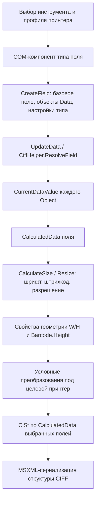

# Формирование полей ClariSoft: восстановленная цепочка

Исследование установленной сборки, 17.10.2026. Адреса ниже — preferred virtual
addresses конкретных файлов из `inventory.json`, а не адреса после ASLR.

## 1. Это несколько алгоритмов, выполняемых последовательно



Создание объекта модели, вычисление значений, расчёт геометрии, конверсия под
принтер и запись XML — отдельные операции. Сам XML writer читает уже подготовленные
свойства; он не выводит тип и конфигурацию из текста `CalcData`.

## 2. Объектная модель и создание

| Уровень | Оригинальная функция | Поведение |
|---|---|---|
| File → SubImage | `CiffMgr!68108DC7` | `ICiffFile.Add`; передаёт создание расширенному методу файла |
| SubImage → Field | `CiffMgr!6811121E` | Создаёт семейство text=0, barcode=1, graphic=2, инициализирует имя и subtype, добавляет в коллекцию |
| Data → Object | `CiffMgr!68108290` | Создаёт объект данных, задаёт внутренний DataType, Index, Static, Parse, вставляет по Index |
| Инициализация text | `CiffMgr!681136F8` | Подтип text=1 включает BlockText; другие значения оставляют обычный текст |
| Инициализация Object | `CiffMgr!68105478` | Раздельно хранит внутренний DataType, Index, Static, Parse |

**CONFIRMED выполнением DLL:** Field сохраняются в порядке коллекции. Повторное
имя заменяет прежнее поле. Object сортируются при добавлении по числовому Index;
повторный Index заменяет прежний объект. Автоматический Index=-1 берётся как
индекс последнего объекта +1, либо 0 для пустой коллекции.

Тип семейства, `ClearStyleFieldType` (строка `FldType`), CLSID обработчика,
внутренний DataType и числовой `ClearStyleDataType` в XML — разные свойства.
В частности, один `FixedText` может содержать разные источники данных.

### Компоненты и основные входы

| DLL | CreateField | UpdateData | CalculateSize | Resize |
|---|---|---|---|---|
| CLCSTextBasedField | `42421F6E` | `42427B81` | `424214EE` | `42426819` |
| CLCSBarcodeField | `41414B7B` | `414164F5` | `414147DE` | `41415C38` |
| CLCSSmallBarcode | `42044117` | `42045786` | `4204402F` | `420450B4` |
| CLCSGraphicBasedField | `41C0AE11` | `41C0CEE0` | `41C0A8F0` | `41C0C4ED` |
| CLCSGraphicPrimitive | `4280DA60` | `4280EFDB` | `4280D85A` | `4280EC05` |
| CLCSBlockTextField | `41811210` | `41812C81` | `41810F9B` | `41812631` |
| CLCSRichTextBlockField | `41817419` | `4181913E` | `41816F4B` | `41818B17` |

В `CLARiSOFT.exe!00E7CD3F` компоненты перечисляются через COM categories,
создаются по CLSID и добавляются в список обработчиков. Один CIFF Barcode может
обрабатываться разными компонентами; строка `Barcode` сама по себе не определяет
все правила рендера. CLSID обычного Barcode-компонента:
`{43C2458C-D5B0-11D4-800A-005004D10645}`; SmallBarcode:
`{7A4AA4CF-F5CD-11D4-8DAE-0050DAFE8A9F}`.

Встроенный text CLSID: `{BB0561B2-C54F-11D4-A995-00010212D541}`.
Прочие CLSID, версии интерфейсов и слоты методов находятся в
`metadata/*.typelib.json` и `metadata/live-vtables.json`.

### Подтверждённые рецепты текстового компонента

- `424231A9`: FixedText, Object внутреннего типа 0, Index=0, Static=1, Parse=0,
  ClearStyleDataType=0, ресурсная строка DefaultText; MaxNoOfChars равен её длине.
- `424233B5`: TimeText, Object типа 0, Static=0, Parse=1,
  ClearStyleDataType=1, Default=`HH':'mm`, MaximumCharacters=0.
- `4242296C`: DateText, Object типа 0, Static=0, Parse=1,
  ClearStyleDataType=2, Default=`dd'/'MM'/'yyyy`, MaximumCharacters=0.
- `424226B2`: CounterText, Object внутреннего типа 5, Static=0, Parse=1,
  ClearStyleDataType=4; создаётся числовой SubCounter с диапазоном 0–9999,
  шагом 1 и четырьмя знаками.

Дальше компонент выставляет шрифт/разрешение pitch по capabilities и вычисляет
данные/размер. Значение pitch из UI может масштабироваться на PitchResolution.
Нельзя переносить только создание голого CiffField и считать его готовым UI-полем.
`GetFieldTypeID` и селекторы ветвей создания не следует отождествлять без проверки:
наблюдаемые имена/ID сохранены в `metadata/field-type-ids.json`, а реальные
вызовы рецептов — в дизассемблировании CreateField.

## 3. Разрешение данных перед сохранением

`CiffHelper!40816DB9` (`ResolveField`) перечисляет объекты Data, вызывает
ResolveData, объединяет их CurrentDataValue и присваивает результат CalculatedData.
Порядок соответствует коллекции объектов. `CLCSTextBasedField!42427B81` и
`CLCSBarcodeField!414164F5` используют аналогичный проход в UpdateData.

Главный dispatcher `CiffHelper!4081673A` ветвится по **ClearStyleDataType**:

| XML DataType | Путь |
|---|---|
| 0 | Fixed / пользовательский текст: `4080E4BE` |
| 1, 2 | Время / дата: `4080D4A9` |
| 3, 7 | OffsetDate / цена: `4080D5B4` |
| 4 | Счётчики: `4080D1EE` |
| 5 | Ссылка на поле: `4080E231`, с обработкой рекурсии |
| 6 | Внешний источник либо его сохранённое значение: `40810976` или Default |
| 8 | EquipmentReference: путь зависит от вида reference |
| 9 | CLARICOM SSCC: `4080D9B3` |

Это не та же таблица, что внутренний `EDataType` коллекции:
`FIXED=0, SOURCEFIELD=1, SOURCEDATA=2, VARIABLETEXT=3, OFFSETDATE=4,
COUNTERTEXT=5, EQREF=6, PRICE=7, CLARICOMSSCC=8`.

После основного разрешения могут применяться checksum-компонент и encryption
по ProgID (`4081A65D`). Это отдельная обработка значений поля, не ClSt transform.
Использование произвольного внешнего ProgID не воспроизводилось в динамических пробах.

### Результаты native-проб

| Конфигурация | CalculatedData |
|---|---|
| Fixed Default=`Hello<&>` | `Hello<&>` |
| Нестатический VariableText, UserEnteredData=`OPERATOR` | `OPERATOR` |
| Нестатический FixedLen, длина 6, PadChar=0, PadMode=Right, Default=abc | `000abc` |
| SrcField=SOURCE со значением ABCDE, StartChar=1, NoOfChars=3 | `BCD` |
| Time, формат HH':'mm | фактическое время DLL |
| Date, формат dd'/'MM'/'yyyy | фактическая дата DLL |
| Numeric SubCounter, Start=0, Current=42, четыре знака, preview count=0 | `0000`; CurrVal остаётся `42` |

`FixedLength` применяется с учётом DataIsStatic и источника. `CurrentValue`
счётчика нельзя автоматически считать текстом preview: при нулевом print count
числовой путь использует StartValue. Resolver может обновлять и сохранённый Default
у динамических источников; конфигурацию ссылок он хранит отдельно.

## 4. Геометрия и DataMatrix

`CalculateSize` и `Resize` зависят от компонента, font API и capabilities.
Для текста используются реальные метрики шрифта; универсальная формула
«число символов × ширина символа» не соответствует этому коду.

Для DataMatrix восстановлены методы `CDataMatrixSmallBarcodeObjHelper`:

| Адрес | Назначение |
|---|---|
| `42049D90` | CalculateSize по SymbolSize и ModuleSize, с переводом по XRes/YRes |
| `42049EA8` | Инициализация параметров поля/данных, с учётом ограничений capabilities |
| `4204A286` | Resize: выбор размера модуля и обновление W/H/BcH |
| `4204A5EB` | Начальные параметры: ECC=5, SymbolSize=3, ModuleSize=50, QuietMargins=0 |
| `4202C07E` | Таблица 30 фиксированных размеров символа |
| `4200434D` | Округление float с добавлением ±0.5 и усечением |

Индекс SymbolSize=6 — 22×22. Индексы 24–29 задают прямоугольные символы.
Resize учитывает единицы U_HMM=0 / U_DOTS=1, ограничивает исходный module до 500,
переводит его в целое число физических точек XRes, минимум 1 точка, затем обратно.
Это даёт квантование, которого нет при обычном округлении миллиметров.

Native `4204A286` выполнен непосредственно из установленной DLL. Capabilities
XRes/YRes в этих пробах заданы явной тестовой заглушкой, не реальным профилем:

| Requested W/H | QuietMargins | ModuleSize | W/H | BcH |
|---|---|---|---|---|
| 1100 | 0 | 50 | 1100 | 1100 |
| 1000 | 0 | 42 | 924 | 924 |
| 500 | 0 | 17 | 374 | 374 |
| 1100 | 1 | 42 | 1092 | 1092 |
| 1000 | 1 | 33 | 858 | 858 |
| 500 | 1 | 17 | 442 | 442 |

Здесь SymbolSize=22×22, XRes=YRes=0.12. В этой конкретной resize-функции margin
сначала увеличивает dimensions для подбора module на 2, а затем ещё раз добавляет
2 module к итоговому размеру. Поведение проверено выполнением, а не исправлено
по предположению. Его нельзя автоматически распространять на каждый renderer.
Исследовательский перенос: `reference-rules.cjs::resizeDataMatrix`.

**CONFIRMED:** CiffMgr writer сам не вычисляет BcH из W/H. Он пишет отдельное
свойство Barcode.Height; native core default=2540. В проверенном DataMatrix resize
renderer согласованно устанавливает W, H и Barcode.Height. Простая замена BcH
на произвольный bounding box в serializer не воспроизводит этот этап.

## 5. Преобразования под целевой принтер

Дополнение с извлечёнными реальными профилями, 54 COM-пробами и полным порядком
XML: [XML_FORMATION_AND_PRINTERS.md](XML_FORMATION_AND_PRINTERS.md).
В частности, `PrinterType` у SubImage хранится отдельно от File.DesignedFor;
его отличие от DesignedFor вызывает запись `SubHeader/@PrinterType`.
Смена только строки DesignedFor не выполняет пересчёт поля под новый профиль.

Это отдельный этап, а не обязательный побочный эффект записи каждого XML.
В `CLARiSOFT.exe!00E4979F` и `00E37009` видны параметры и вызовы двух converter-ов.
Путь зависит от запроса (JobSelection, Print Preview и другие) и capabilities.

`CLCiffConversion_Data.dll` содержит Database Resolve, Field Resolve,
Char Translate и дополнительные преобразования значений.
`CLCiffConversion_Layout.dll` содержит:

1. Cull — проверку/исключение несовместимых полей/объектов;
2. Resolution Adjust;
3. Font Convert;
4. Resolve Field Width;
5. Field Order, когда этот режим включён;
6. Position;
7. Add Tab Fields;
8. Tag;
9. RTBF2LOGO и специализированные ветви, включая Zipher Barcode.

Это перечень фаз и зависимостей, а не утверждение, что они всегда включены.
Public Convert, Parameter и init-методы записаны в
`metadata/conversion-methods.json`; сами функции обоих converter DLL экспортированы
целиком из .text в `decompiled/`, включая функции без восстановленных имён.

Прямое сохранение CiffMgr сохраняет порядок текущей коллекции Field.
Conversion Field Order может изменить эту коллекцию раньше; поэтому это
не универсальная гарантия исходного insertion order для каждого пути приложения.

## 6. Запись CIFF

Основной путь writer:

```text
68129209  XML declaration + ImageDesign
  6812DC1C root attributes, Header, SubImages, GenericSettings, Embedded
    68129BFC Header / DateOffsets и другая metadata
    6812CAD1 SubImage collection
      6812BFEC SubHeader + перечисление Field
        6812C2CA SubHeader
        68128924 Field
          6812708A Data collection
            68126560 Object
          6812CCCE Text
          68124AFE Barcode
          68129475 Graphic
```

Все создаваемые узлы добавляются через MSXML3 DOM. Формат записи — UTF-16 или
UTF-8 по ESaveFormat. Обычный UTF-16 XML возвращается с CRLF; сохранённые oracle
файлы дополнительно имеют UTF-16LE BOM.

### Порядок и условия общего Field

Writer: `68128924`. Сначала атрибуты Name и условный TXField, затем:

| Узел | Когда записывается |
|---|---|
| FldType | ClearStyleFieldType непустой |
| CLSID | Отличается от text CLSID `{BB0561B2-C54F-11D4-A995-00010212D541}` |
| Displayed | FieldDisplayed != 1 |
| X, Y, W, H | Всегда, в том числе нули |
| Ln | FieldLine != 0 |
| Orientation | != 0 |
| OverrideThis, Inverse, Mirror | Соответствующее значение != 0 |
| RenderMode | != 0, значение через native enum formatter |
| CalcData | Непустой CalculatedData, после удаления запрещённых control chars |
| LoggedField | Значение не равно `Not Logged`; NULL/пустая строка дают пустой узел |
| Origin | Поддерживается extension и значение != 0 |
| MarkSet | Поддерживается extension и строка непустая |
| Data | FieldData существует; пустая коллекция даёт Data/ |
| Clip | Существует clipping и содержит прямоугольники |
| Text / Barcode / Graphic | По внутреннему FieldType: 0 / 1 / 2 |

CalcData фильтрует U+0000–U+001F, сохраняя TAB, LF, CR (`68124340`, `6812451F`).
MSXML при выдаче XML дополнительно нормализует переводы строк CDATA к CRLF.
Имена полей не перенумеровываются serializer-ом.

### Data/Object

Writer: `68126560`. Атрибуты в порядке:
Index (если !=0), Static (если !=1), Parse (если !=0), EqRef (если !=0),
Param (условный extension), Reference (при поддержке соответствующего интерфейса).
Поддерживаемый пустой Reference записывается как `Reference=""`.

Далее общий порядок:
`DataType`, `Locale`, `Calendar`, `Encryption`, `MaxNoOfChars`, `Default`,
`FixedLen`, `PriceData`, `Checksum`, затем блок источника.

| Свойство | Правило |
|---|---|
| DataType | Всегда ClearStyleDataType |
| Locale | Отличается от EN-GB |
| Calendar | Отличается от 1 |
| Encryption | Непустая строка |
| MaxNoOfChars | MaximumCharacters != 0 |
| Default | DefaultData непустая; CDATA |
| FixedLen | FixedLength != 0; сам тег может быть пустым |
| FixedLen/PadChar | Не пробел U+0020; один символ в CDATA |
| FixedLen/PadMode | != 0 |
| PriceData / Checksum | Непустые ссылки/типы соответствующих extension |

Блок источника выбирается **внутренним** DataType:

| Внутренний тип | Блок | Writer |
|---|---|---|
| 0 | Нет дополнительного блока | — |
| 1 | SrcField, атрибут SrcFieldName, условные StartChar/NoOfChars/SelectMode | `6812B98E` |
| 2 | SrcData: условный ConnStr, SrcSQL даже при пустом значении, substring/select | `6812B7E4` |
| 3 | VarText: Prompt, Mask, UserEnterData, PromptAtCoder, ResetOnSel, ListData | `6812D7A8` |
| 4 | OffsetDate, атрибут SrcOffset | `6812A724` |
| 5 | CounterText и SubCnt | `681261DF`, `6812BB40` |
| 8 | CLARICOMSSCC | `68126560` |

VarText не появляется только от `Static=0`. Его задаёт внутренний тип источника.
OffsetDate не выбирает Header DateOffset по позиции в этой функции записи:
используется сохранённое имя SrcOffset.

### Text

`6812CCCE` создаёт Font и условные Bold, Italic, DblSpace, Block, Escapement,
FixedWidth, MultiStroke. Font writer `6812D1DE` пропускает defaults:
Face=Arial, Family=32, Pitch=13, PitchResolution=1, XMag=100, YMag=100,
TTSize=1, TxtDir=0, CharSpace=0.
Block writer `68125C42` пишет BlkW, BlkH, MinFontSize всегда, остальные — по условиям.
BlockText является признаком модели, не следствием ненулевого BlkW.

### Barcode

`68124AFE`: Mag при отличии от 1000, MagRnd при отличии от 50, BcH всегда,
HR/HRFont, условные CheckDigit, QuietMargin (default=1), XOffSet,
BarcodePrinting, затем subtype container.

27 subtype-ов и их **точные feature masks** перечислены в `SERIALIZATION_MAP.md`.
Для DataMatrix (`subtype=15`, mask=0x380) writer `68124E3D` пишет:
ECCType при отличии от 5, ModuleSize при отличии от 100, SymbolSize при отличии от 0.
Для QR, PDF417, MicroPDF417 и остальных типов используются собственные mask-биты;
универсальная вставка всех Barcode-настроек не соответствует native.

### Graphic

`68129475`: GfxW/GfxH, затем Primitive, StaticGfx, VariableGfx либо EmbeddedGfx.
Для raster/logo веток: условные AspectRatio (default=1), ResizeFrame (default=0),
LogoReferencePrinter. Для Primitive: Shape, LineW; у complex shape — список Point
с координатами. Содержимое изображения/ссылка и геометрия — разные части модели.

Полный адресный индекс: **309 констант тегов, 42 writer-функции, 311 мест записи**
в `serialization-map.json` и `SERIALIZATION_MAP.md`. Для каждого места есть
ссылка на функцию C и строку; все условия/HRESULT-ветви сохранены в C и ASM.
Индекс сам по себе не является исполняемым сериализатором.

## 7. Место ClSt в полном цикле

`ICiffField.CalculatedData` — слот `+0x98`, IID
`{B2A04AE2-991E-444D-B6EB-C9171E8AB98F}`. Именно это свойство читает
`68118A19` при сборке выбранного ClSt payload. Имя ключа `TagData` не означает
существование отдельного неизвестного XML-поля с таким именем.

Генератор ClSt не пересчитывает дату/время сам: берёт текущий CalculatedData.
Следовательно, перед ним должны завершиться нужные Resolve/UpdateData операции.
Он вызывается до XML-фильтрации control chars в CalcData; сравнение payload с
уже очищенным XML имеет это ограничение.

`savetostring()` делегирует `savetostring2(UTF_16,0)` и не генерирует ClSt.
`savetostring2(...,1)` и обычный save включают соответствующий этап.
Обёртки `68109ABF`, `68109A6F`, writer-входы `6812FE7F`/`6812FC26` это подтверждают.

Четыре оригинальных COM-результата (FixedText, пустой SubImage, TimeText,
DataMatrix) совпали с ранее восстановленным независимым ClSt pipeline при подаче
фактически выбранной native-маски. Это проверка всего native COM-генератора,
дополняющая прежние тесты отдельных transform-функций.

## 8. Границы подтверждения

**CONFIRMED:** приведённые адреса/ветви по DLL и ASM; 142 native-сценария модели
(137 CIFF и 5 ожидаемых отказов свойств); 6 direct-native DataMatrix resize;
4 совпадения полного COM ClSt с независимым генератором.

**INFERRED:** перенос найденных схем на неподтверждённые варианты полей/профилей,
где совпадает COM-интерфейс и исходный путь. В частности, нельзя считать каждый
экспортированный renderer полностью проверенным только из-за наличия C-декомпиляции.

**UNKNOWN / требуется отдельная проверка:** эквивалентность всех шрифтов и Unicode
скриптов, автоматического выбора размера/кодирования всех Barcode, реальные внешние
источники и COM-encryption/checksum компоненты, все сочетания capabilities,
преобразования printer-specific download и принятие файлов физическим Videojet.
Прошивка/принтер в этом исследовании не использовались. Полная независимая замена
всех renderer-ов и converter-ов в Glyph не реализована этим набором файлов.
