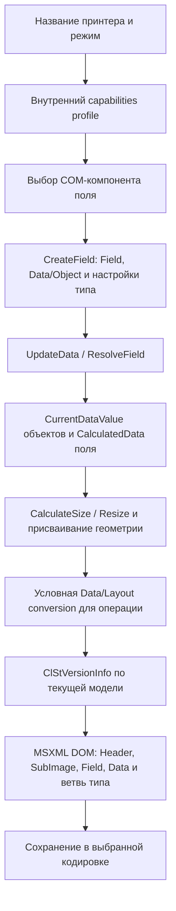

# Как CLARiSOFT формирует CIFF/XML и что зависит от принтера

Исследование установленной сборки, 17.10.2026. Основные источники — машинный код
оригинальных EXE/DLL, встроенные COM type libraries, исполнение оригинальных COM
методов и файлы из `C:\Users\GigaGeorge\Desktop\w_project\Templates VideoJet`.

**Основной результат:** схема записи CIFF общая. Профиль принтера влияет прежде
всего на подготовку модели: возможности поля, разрешение, шрифты, размеры,
настройки печати и условную конверсию. Writer затем записывает свойства модели
в фиксированном порядке, пропуская значения по умолчанию. Поэтому совпадение
`FldType` или изменение одной строки `DesignedFor` ещё не означает эквивалентность
двух шаблонов для разных принтеров.

## Доказательства и область проверки

- [FIELD_FORMATION_SPEC.md](FIELD_FORMATION_SPEC.md): ранее восстановленные
  создание полей, resolver, геометрия и serializer; использованы без повторного
  исследования с нуля.
- [SERIALIZATION_MAP.md](SERIALIZATION_MAP.md): 42 writer-функции и 311 мест
  записи, включая редко используемые ветви. [JSON-индекс](serialization-map.json).
- [printer-profile-verification.json](printer-profile-verification.json): новое
  выполнение 54 COM-сценариев: 18 реальных профилей DataFlex, 18 замен только
  DesignedFor и 18 согласованных замен metadata файла/подизображения.
- [native-printer-capabilities.json](native-printer-capabilities.json): 65 названий
  Videojet, отображённых на 41 внутренний профиль установленного драйвера.
- [template-corpus.json](template-corpus.json): полный структурный разбор папки.

SHA-256 всех 15 EXE/DLL из прежнего `inventory.json` заново проверены: совпадают
с файлами, для которых сохранены C-декомпиляции и адресный ASM. Адреса ниже —
preferred VA этих конкретных бинарников; после ASLR фактический адрес иной.

Новые пробы используют реальные capabilities из DLL, а не заглушку разрешения.
Они проверяют отдельные стадии модели: для текста CreateField → UpdateData →
CalculateSize, для явно настроенного DataMatrix — публичные Resize/CalculateSize.
Размещение текста приложением и присваивание его W/H здесь не эмулируются:
в этих изолированных CIFF текстовые W/H остаются 0. Эти CIFF — диагностические
образцы, не готовые задания для производства. ClSt в новых пробах отключён,
чтобы его случайность не влияла на сравнение; для самого ClSt есть отдельные
ранее выполненные native-проверки.

## 1. Полная последовательность стадий



Это зависимости стадий, а не утверждение, что каждый путь приложения запускает
все операции заново при каждом Save. Например, обычный CiffMgr serializer не
вызывает заново renderer, не разрешает ссылки и не пересчитывает дату.

### 1.1 Выбор принтера

Драйвер содержит XML-ресурс `CLZipherBCP2.dll / XMLFILE / 203 / lang 2057`,
2 111 101 байт. SHA-256 DLL:
`5e4f9c6615fc1b39d235beb5103e9f0ca044bd2b110dbe53c41c05c945bf7429`.
В ресурсе есть `Configurations/Mappings` и `CoderCapabilities`.

Внешнее имя вроде `DataFlex 6330(53mm) - Continuous` сначала переводится во
внутреннее `Forrester Continuous`. Это не имя отдельной XML-схемы CIFF.
Capabilities определяют разрешение, допустимые шрифты/штрихкоды, пределы,
источники данных и дополнительные настройки.

### 1.2 Создание объекта поля

`CLARiSOFT.exe!00E7CD3F` обнаруживает обработчики через COM categories.
Текст, обычный Barcode, SmallBarcode, графика, примитивы, BlockText и RichText
обслуживаются отдельными DLL. Их адреса входов приведены в
[спецификации стадий](FIELD_FORMATION_SPEC.md).

Core-модель создаётся методами:

| Операция | Функция | Что задаётся |
|---|---|---|
| Создать SubImage | `68108DC7` | Ссылка, format, размеры, rotation |
| Добавить Field | `6811121E` | Семейство text=0 / barcode=1 / graphic=2, имя, subtype |
| Добавить Data/Object | `68108290` | Внутренний тип источника, Index, Static, Parse |
| Инициализировать Object | `68105478` | Независимые свойства типа/индекса/флагов |

Имя передаётся из вызывающего кода. Writer его не генерирует и не переименовывает
в `Field00`, `Field01` и т. п. Точный UI-алгоритм выбора очередного свободного
автоимени этой серией проб не проверялся.

У поля одновременно существуют независимые классификации:

1. Семейство COM-модели определяет, будет ли последняя ветвь `Text`, `Barcode`
   или `Graphic`.
2. `ClearStyleFieldType` определяет текст тега `FldType`.
3. `CLSID` выбирает компонент обработки/рендера.
4. Внутренний `EDataType` каждого Object определяет вложенный блок источника.
5. `ClearStyleDataType` каждого Object записывается числом в XML `DataType`
   и участвует в разрешении значений.

Следовательно, строка `FixedText` не означает, что внутри обязательно только
постоянная строка. Поле может состоять из нескольких источников.

### 1.3 Начальные рецепты текста

Оригинальный `CLCSTextBasedField.dll` создаёт:

| Инструмент | Внутренний источник | XML DataType | Static / Parse | Начальное содержимое |
|---|---:|---:|---|---|
| FixedText | 0 | 0 | 1 / 0 | Ресурсная строка `DefaultText`, MaxNoOfChars=11 в этой сборке |
| TimeText | 0 | 1 | 0 / 1 | `HH':'mm` |
| DateText | 0 | 2 | 0 / 1 | `dd'/'MM'/'yyyy` |
| CounterText | 5 | 4 | 0 / 1 | SubCounter: 0…9999, шаг 1, четыре знака |

Адреса рецептов: `424231A9`, `424233B5`, `4242296C`, `424226B2`.
OffsetDate, EquipmentReference, Price и внешние источники имеют свои ветви.
Выбор User-entered для текста меняет конфигурацию источника на VariableText;
это не добавление универсального `VarText` ко всем текстовым полям.

### 1.4 Вычисление содержимого

`CiffHelper!40816DB9` перечисляет Data/Object, разрешает каждый источник,
склеивает `CurrentDataValue` и присваивает `ICiffField.CalculatedData`.
Компоненты текста/Barcode имеют соответствующие UpdateData.

Dispatcher `4081673A` использует XML/ClearStyle DataType:
0 — fixed/user text; 1/2 — время/дата; 3/7 — offset date/цена;
4 — counter; 5 — ссылка на поле; 6 — внешний источник; 8 — equipment reference;
9 — SSCC. Checksum и encryption-компоненты могут дополнительно преобразовать
значение. `Encryption` источника и `ClStVersionInfo` — разные механизмы.

Ссылки разрешаются до получения итогового CalcData. Для SrcField учитываются
StartChar/NoOfChars/SelectMode и рекурсия. Для FixedLen учитываются источник,
DataIsStatic, длина и padding. У счётчика preview может брать StartVal, хотя
сохранённый CurrVal другой. Native-пример: CurrVal=42, StartVal=0, print count=0
даёт `0000`, не `0042`.

### 1.5 Геометрия

CalculateSize/Resize принадлежат обработчику типа. Они используют реальные
метрики шрифта, subtype Barcode, разрешение и capabilities. Присвоение W/H —
отдельное действие; вызов CalculateSize сам по себе не делает каждое поле
полностью подготовленным к печати.

Для DataMatrix из SmallBarcode установлено: native Resize квантует модуль
по разрешению и обновляет W, H, Barcode.Height. Writer записывает BcH из
отдельного свойства `Barcode.Height`, не исправляет его по W/H.
При 22×22 и выключенных quiet margins `BcH = 22 × ModuleSize`.
При margins/другом renderer нельзя механически подставлять эту упрощённую
формулу: отдельный native-тест margins описан в FIELD_FORMATION_SPEC.

### 1.6 Преобразования перед экспортом/передачей

`CLCiffConversion_Data.dll` разрешает БД/поля и преобразует данные.
`CLCiffConversion_Layout.dll` может исключить несовместимые объекты,
скорректировать разрешение/шрифт/ширину/позицию, изменить порядок полей,
добавить tab/tag fields, преобразовать rich text в logo и применить
специализированные Barcode-ветви.

Параметры видны в `45428C0B`: `CS Cull`, `CS Resolution Adjust`,
`CS Font Convert`, `CS Resolve Field Width`, `CS Field Order`, `CS Position`,
`CS Add Tab Fields`, `CS Tag`, `CS Zipher Barcode`, `CS RTBF2LOGO` и другие.
`4541A4F7` собирает список фаз по настроенным приоритетам 1…9.
Это условные преобразования, а не жёсткая последовательность всех фаз для Save.
Путь Print/JobSelection и его параметры видны в `CLARiSOFT.exe!00E4979F`.

### 1.7 ClSt и запись

ClSt берёт текущее `ICiffField.CalculatedData` (+0x98), до XML-фильтрации
контрольных символов. Оно должно соответствовать состоянию модели после
нужного обновления/конверсии. Генератор использует случайную маску, поэтому
побайтовое отличие двух ClSt не является доказательством отличия полей.

`savetostring()` вызывает UTF-16 без генерации ClSt. В
`savetostring2(format, flag)` генерация включается соответствующим flag;
обычный native save также запускает её. Адреса: `68109ABF`, `68109A6F`,
`6812FE7F`, `6812FC26`. Подробности и четыре совпадения полного native COM
генератора — в FIELD_FORMATION_SPEC и [исследовании ClSt](../clst/README.md).

## 2. В каком порядке появляются поля и сегменты

### 2.1 Field внутри SubImage

Без дополнительной перестановки — **порядок текущей коллекции**, обычно порядок
добавления. Не алфавитный порядок имён и не автоматическая сортировка по X/Y.
Writer `6812BFEC` просто перечисляет коллекцию и вызывает `68128924` для каждого
элемента. Имена `Z`, `A`, `M` сами по себе не превращаются в `A`, `M`, `Z`.

Повторное имя при Add заменяет существующий элемент. SendtoFront/SendtoBack,
SetFieldOrder и действия приложения могут изменить коллекцию до записи.

Отдельный `CS Field Order`, `45416CEB`, сортирует по паре **(FieldLine, X)**,
по возрастанию, затем удаляет и добавляет элементы в полученном порядке.
При равных ключах новая запись идёт после существующих: порядок равных ключей
сохраняется. Для line-based format и Ln=0 предусмотрен RoundToNearestLine
(`45421114`). Эта ветвь установлена по C/ASM; её включение для всех printer
download путей динамически не проверялось.

Значит, корректное правило: «порядок коллекции на момент записи».
Правило «всегда порядок создания» не покрывает перестановку/конверсию.

### 2.2 Object внутри Data

Добавление сортирует элементы **по числовому Index**. Например, Add с индексами
2, 0, 1 сериализуется как 0, 1, 2. Повторный Index заменяет прежний Object.
Index=-1 означает следующий после последнего, либо 0 в пустой коллекции.
Index=0 обычно не печатается как атрибут — это не отсутствие первого сегмента.

В этом порядке разрешаются и склеиваются сегменты. Для DataMatrix это порядок
содержимого кода. Расстановка Field в XML и порядок сегментов Barcode —
разные независимые уровни.

Оба поведения подтверждены оригинальной DLL; fixtures:
`oracle/field-collection-order.ciff`, `data-collection-order.ciff`,
`duplicate-field-name.ciff`, `duplicate-data-index.ciff`.

## 3. Порядок самого XML-документа

Основной writer: `68129209` → `6812DC1C`.

```text
XML declaration
ImageDesign [Version, InternalName?, xml:space, Temporary?]
  Header
  SubImage ...                       — по коллекции SubImages
    SubHeader
    Field ...                        — по текущей коллекции Field
  GenericSettings
  Embedded?                          — если есть файлы и разрешено режимом save
```

Header пишет атрибуты DesignedFor, DesignedWith, OverrideAll с пропуском
соответствующих defaults (`Generic`, `CLARiSOFT`, 0), затем:
`Units? → ErrorLeniency? → ClStVersionInfo? → LastDownloaded? → LineID? →
DateOffset* → Price* → параметры расширений` (`68129BFC`).

SubHeader (`6812C2CA`) сначала пишет атрибуты:
`FormatName? → PrinterType? → PrinterFormatName?`, затем элементы:

```text
ImageWidth → ImageHeight → ImageRotation? → MaxImageWidth → MaxImageHeight
→ AutoSize? → ImageMirror? → ImageInverse? → XRes → YRes?
→ CurrentOrientation? → LastUpdated?
```

`YRes` пропускается, если равен XRes. Опциональные rotation/mirror также имеют
внутренние enable-флаги. Enum может выводиться в XML иначе, чем его внутреннее
число; например, не следует переносить условие internal orientation !=0
непосредственно на текст XML `CurrentOrientation`.

`MaxImageWidth/Height` — свойства конкретного SubImage, которые writer пишет
как есть. Они могут быть выбранной рабочей областью, меньшей hardware maximum.
Отдельные аппаратные/профильные пределы нужно получать из capabilities.
`ImageWidth/Height` и `MaxImage*` также не тождественны друг другу:
см. [CIFF_TEMPLATE_DIMENSIONS.md](../../CIFF_TEMPLATE_DIMENSIONS.md).

MSXML формирует узлы DOM, экранирует атрибуты, использует CDATA для ряда строк.
Native поддерживает UTF-8 и UTF-16. Для обычных UTF-16 CIFF в папке характерны
UTF-16LE BOM и CRLF. Сериализатор пропускает default-свойства, поэтому отсутствие
тега часто означает конкретный default, а не отсутствие функции у принтера.

## 4. Полный общий каркас Field и условия дополнительных параметров

Writer: [68128924](decompiled/CiffMgr.dll/FUN_68128924.c).
Порядок строк таблицы — порядок добавления дочерних элементов.

Атрибут `Name` записывается первым. `TXField` появляется, когда соответствующее
extension-свойство поддерживается и включено.

| Элемент | Условие записи |
|---|---|
| FldType | Непустой ClearStyleFieldType |
| CLSID | CLSID отличается от встроенного text CLSID `{BB0561B2-C54F-11D4-A995-00010212D541}` |
| Displayed | !=1 |
| X, Y, W, H | Всегда, включая нулевые значения |
| Ln | !=0 |
| Orientation | !=0 |
| OverrideThis | !=0 |
| Inverse | !=0 |
| Mirror | !=0 |
| RenderMode | !=0; используется native enum formatter |
| CalcData | CalculatedData непустой; строка очищается перед записью |
| LoggedField | Значение не равно строке `Not Logged`; пустое/NULL даёт пустой узел |
| Origin | Есть extension, значение !=0 |
| MarkSet | Есть extension, строка непустая |
| Data | Существует FieldData; пустая коллекция может дать `<Data/>` |
| Clip | Есть clipping rectangles |
| Text / Barcode / Graphic | По семейству COM-модели, не по содержимому строки FldType |

CalcData удаляет U+0000…U+001F, кроме TAB, LF и CR. MSXML при выдаче CDATA
нормализует переводы строк к CRLF. Правила и fixtures — `reference-rules.cjs`
и `oracle/common-CalculatedData.ciff`.

Так объясняется пустой LoggedField у части файлов: это конкретное значение
свойства, а не обязательный XML-маркер всех полей. Полная прикладная роль
журналирования, помимо условия сериализации, не установлена.

## 5. Data/Object: порядок и условия

Writer: [68126560](decompiled/CiffMgr.dll/FUN_68126560.c).

Сначала атрибуты:

| Атрибут | Условие |
|---|---|
| Index | !=0 |
| Static | !=1 |
| Parse | !=0 |
| EqRef | !=0 |
| Param | Поддерживаемое extension, значение !=0 |
| Reference | Поддерживается interface; в том числе `Reference=""` |

Затем дочерние элементы:

| Элемент | Условие |
|---|---|
| DataType | Всегда, это ClearStyleDataType |
| Locale | Не EN-GB |
| Calendar | Внутреннее значение не 1 |
| Encryption | Непустой ProgID/строка |
| MaxNoOfChars | MaximumCharacters !=0 |
| Default | Непустая строка, CDATA |
| FixedLen | FixedLength включён |
| PriceData | Непустой SrcPrice в поддерживаемом extension |
| Checksum | Непустой тип checksum в поддерживаемом extension |
| Блок источника | По внутреннему EDataType, таблица ниже |

В FixedLen: `PadChar` пишется, если это не пробел U+0020;
`PadMode` — если internal mode !=0. Поэтому `<FixedLen/>` имеет смысл даже
без дочерних тегов. FixedText, Static=0 и MaxNoOfChars по отдельности **не**
включают FixedLen.

В PriceData сначала атрибут `SrcPrice`, затем `HigherFmt?`, `LowerFmt?`,
`SwitchVal?`. Переключение форматов требует положительного switch и обоих
форматов; writer нормализует неполную конфигурацию. В Checksum — атрибут Pos
и CDATA Type. Это не свойство внешней строки FldType.

### Блок источника

| Внутренний EDataType | Что пишется |
|---:|---|
| 0 FIXED | Дополнительного блока нет, в том числе для Date/Time с Parse=1 |
| 1 SOURCEFIELD | SrcField с атрибутом SrcFieldName; StartChar?, NoOfChars?, SelectMode? |
| 2 SOURCEDATA | SrcData: ConnStr?, SrcSQL, StartChar?, NoOfChars?, SelectMode? |
| 3 VARIABLETEXT | VarText: пользовательский ввод, prompt/mask/list |
| 4 OFFSETDATE | OffsetDate с атрибутом SrcOffset |
| 5 COUNTERTEXT | CounterText и его SubCnt |
| 6 EQREF | Специального child-блока в этой ветви writer нет; используются общие свойства/EqRef |
| 7 PRICE | Специального source child-блока нет; PriceData формируется extension выше |
| 8 CLARICOMSSCC | CLARICOMSSCC |

В SrcField/SrcData StartChar, NoOfChars и SelectMode пишутся при ненулевом
значении. SrcFieldName пишется как атрибут, SrcSQL — даже пустой. ConnStr
для SrcData пропускается при пустой строке.

В OffsetDate сохраняется именно имя SrcOffset; соответствующий DateOffset
должен существовать в Header. Writer не подбирает его автоматически по позиции.

### VarText

Порядок: `Prompt? → Mask? → UserEnterData? → PromptAtCoder? → ResetOnSel?
→ ListData?` (`6812D7A8`). Первые три строки пишутся, если непустые;
PromptAtCoder — если !=1, ResetOnSel — если !=0. ListData появляется при наличии
элементов списка или непустого SQL-источника; содержит mask, ConnStr, SourceSQL
и элементы списка, если они есть. Сохранённый ввод может обновляться resolver-ом.

### CounterText / SubCnt

CounterText: `Rollover? → PrnPerCnt? → ResetOnSel? → ParentCounter?
→ RolloverError? → PromptWith? → ResetSource? → SubCnt*` (`681261DF`).
Defaults соответственно 1, 1, 0, пустая строка, 1, 0, 0.
SubCnt включается в XML только при ненулевом NumberOfCharacters.

SubCnt (`6812BB40`) имеет атрибут Significance всегда;
AlphaNum — если !=0, LeadChar — если не `0`, Global — при включённом global.
Далее:

| Элемент | Условие |
|---|---|
| NoOfChars | Всегда для записываемого SubCnt |
| LeadingChars | !=1 |
| StartVal | Не строка `0` |
| EndVal | Не строка `9999` |
| StepSize | !=1 |
| CurrVal | Непустой |
| IncableChars | Не `0-9` |
| Prompt | Непустой |
| ClrStCntType | Записывается, в том числе пустой |

## 6. Text и его дополнительные параметры

Порядок: `Font → Bold? → Italic? → DblSpace? → Block? → Escapement?
→ FixedWidth? → MultiStroke?` (`6812CCCE`).

- Bold появляется при включении BoldText; атрибут Weight содержит вес.
- Italic и DblSpace пишутся при ненулевом значении.
- Block появляется по признаку BlockText модели, не просто из-за ненулевой BlkW.
- В Block: атрибут Compatibility при !=1, затем BlkW, BlkH, MinFontSize всегда,
  BlkJustify при !=0, Hyphenation при !=0 (`68125C42`).
- Escapement, FixedWidth, MultiStroke дополнительно ограничены ветвью
  FontTrueTypeSize=2 / поддерживаемыми расширениями. Escapement пишется, если
  отличается от FieldOrientation. FixedWidth появляется, если специальная
  ширина отличается от FieldWidth или включено выравнивание. MultiStroke — !=1.

В Font порядок/defaults (`6812D1DE`):

| Порядок | Элемент | Пропускается, если |
|---:|---|---|
| 1 | Face | Arial |
| 2 | Family | internal 32 |
| 3 | Pitch | 13 |
| 4 | PitchResolution | 1 |
| 5 | XMag | 100 |
| 6 | YMag | 100 |
| 7 | TTSize | 1 |
| 8 | TxtDir | 0 |
| 9 | CharSpace | 0 |

Поэтому `<Text><Font/></Text>` — допустимый результат defaults. Набор
сериализуемых свойств не доказывает наличие конкретного шрифта на принтере.

## 7. Barcode, DataMatrix и другие subtype

Общий порядок (`68124AFE`): `Mag? → MagRnd? → BcH → HR → CheckDigit?
→ QuietMargin? → XOffSet? → BarcodePrinting? → subtype container`.

| Элемент | Условие |
|---|---|
| Mag | !=1000 |
| MagRnd | !=50 |
| BcH | Всегда, отдельное Barcode.Height |
| HR | Создаётся, внутри HRFont даже при defaults |
| CheckDigit | !=0 |
| QuietMargin | !=1; выключение обычно даёт `<QuietMargin>0</QuietMargin>` |
| XOffSet | !=0 |
| BarcodePrinting | !=0 и поддерживается extension |

В HR порядок: `HRDisplayed? → HRPos? → HRFont → HRPrintCheckDigit?`.
Defaults 0, 0 и 1 для соответствующих флагов. У HRFont свой default Face=OCRB
и TTSize=0; остальные общие defaults Family=32, Pitch=13, XMag/YMag=100,
TxtDir=0. Нельзя копировать все defaults обычного Text/Font в HRFont.

Внутри subtype writer `68124E3D` использует **feature mask конкретной
символогии**. Все 27 subtype/masks есть в SERIALIZATION_MAP; это не switch по
модели принтера. Для DataMatrix ID=15, mask=0x380:

```text
DataMatrix
  ECCType?     — ECCType !=5
  ModuleSize?  — ModuleSize !=100
  SymbolSize?  — internal SymbolSize !=0 (Auto)
```

Начальный renderer-рецепт может задать ModuleSize=50 и SymbolSize=3, хотя
serializer-defaults — 100 и 0. **Начальный выбор инструмента и пропускаемый
default serializer-а — разные значения.** Для 22×22 internal SymbolSize=6,
XML-строка `22X22`.

Дополнительные subtype-параметры в порядке writer-а:

| Параметр | Бит mask | Дополнительное условие |
|---|---|---|
| ParentField (атрибут) | 0x1 | Записывается в поддерживающей ветви |
| GuardBars | 0x2 | !=0 |
| BearerBars | 0x4 | !=0 |
| BearerBox | 0x8 | !=0 |
| HGauge | 0x10 | !=0 |
| ThickThinRatio | 0x20 | !=517 |
| IntelligentEan128 | 0x40 | !=0 |
| ECCType | 0x80 | !=5 |
| ModuleSize | 0x100 | !=100 |
| SymbolSize | 0x200 | !=0 |
| RowHeight | 0x400 | !=3 |
| Columns | 0x800 | Записывается при поддержке interface |
| Rows, условный атрибут Pad | 0x4000 | Rows записывается; Pad — при включённом rows padding |
| ErrorCorrection | 0x1000 | !=9 |
| Type | 0x2000 | !=0 |
| Encoding | 0x8000 | !=0 |
| HRStyle | 0x10000 | !=0 |
| QRVersion | 0x20000 | !=0 |
| QRErrorLevel | 0x40000 | !=1 |
| QRMirror | 0x80000 | !=0 |
| BearerSize | 0x100000 | Включён соответствующий bearer-size override |
| QMSize | 0x200000 | Включён quiet-margin-size override |
| LegacyC128Enc | 0x400000 | !=1 |
| ManualCode128Encoding | 0x8000000 | !=0 |
| CorrectCheckDigit | 0x10000000 | !=0 |
| Mode | 0x1000000 | !=2 |
| Symbol | 0x2000000 | !=1 |
| SymbolCount | 0x4000000 | !=1 |
| BarcodeDataFormat | 0x20000000 | !=0 |

Для многих строк требуется также QueryInterface соответствующей версии
Barcode interface. Маска разрешает свойство; сама по себе она не требует
записать значение, равное default. Нельзя добавлять QR/PDF417-настройки в
DataMatrix только потому, что они доступны в общем интерфейсе Barcode.

## 8. Graphic

`68129475`: сначала GfxW и GfxH, затем ветвь subtype:

- 0: Primitive → Shape, LineW; для complex shape — ComplexShape и Point*
  с атрибутами ID/X/Y.
- 1: StaticGfx; 2: VariableGfx; 3: EmbeddedGfx.
  В этих ветвях AspectRatio пишется при !=1, ResizeFrame при !=0,
  LogoReferencePrinter — при поддержке extension и !=0.

Данные/ссылка изображения и геометрия различаются. При конверсии renderer может
получить bitmap/logo вместо исходного text/barcode/rich-text объекта; это
изменение модели до работы общего writer-а.

## 9. Различия профилей DataFlex: подтверждённая таблица

Значения ниже взяты **из установленной версии драйвера**, не из внешнего
каталога оборудования. Raw units capabilities — dots. Разрешение 0.12 означает
точек на 0.01 мм: 12 точек/мм, 0.08 — 8 точек/мм.

| Модель/голова | Внутренний профиль | Точек/мм | Max W, dots | Max H Continuous / Intermittent, dots | Default H Continuous, dots |
|---|---|---:|---:|---:|---:|
| 6230 / 32 мм | Independence(32mm) | 8 | 256 | 800 / 376 | 376 |
| 6320 / 32 мм | Zodiac(32mm) | 12 | 384 | 2454 / 900 | 900 |
| 6320 / 53 мм | Zodiac | 12 | 640 | 2454 / 900 | 900 |
| 6420 / 53 мм | Zodiac | 12 | 640 | 2454 / 900 | 900 |
| 6420 / 107 мм | Zodiac(107mm) | 12 | 1280 | 2454 / 900 | 1280 |
| 6330 / 53 мм | Forrester | 12 | 640 | 2400 / 900 | 900 |
| 6530 / 53 мм | Nimitz | 12 | 640 | 3600 / 900 | 900 |

Например, 640 dots / 12 = 53.333… мм; Default H=900 dots / 12 = 75 мм.
Пределы Continuous по высоте: 204.5 мм у Zodiac, 200 мм у Forrester,
300 мм у Nimitz. Это объясняет, почему множество разных моделей создаёт
начальную область высотой 75 мм, хотя максимумы профилей различаются.
Значение 7500 в CIFF само по себе не сообщает аппаратный maximum.

6320/6420 53 мм в одном режиме ссылаются **на один и тот же профиль**, поэтому
отдельных различий этого профиля в них нет. 6330 и 6530 имеют отдельные имена,
но структуры текста и Barcode в заданных контрольных сценариях совпали.
Среди отличий Forrester/Nimitz от Zodiac есть предел высоты, состав clustered
coders и NamedParameter `RejectMachineCyclesCount` с mapping
`Local:Devices/PHds/1/IAssure/RejectMachineCyclesDelay` (default=15, range=1…100).
Наличие этого параметра capabilities не означает его обязательную вставку
в каждый XML-шаблон.

### 9.1 Native-контроль размера DataMatrix

Общий вход: Field Barcode subtype=15, SymbolSize=6 (22×22), ModuleSize=50,
QuietMargins=0, requested rectangle 1000×1000 в U_HMM, то есть 10×10 мм.

| Реальный профиль | XRes | ModuleSize после Resize | W/H | BcH |
|---|---:|---:|---:|---:|
| Исследуемые 6320/6330/6420/6530 и их aliases | 0.12 | 42 | 924 | 924 |
| 6230, оба режима | 0.08 | 38 | 836 | 836 |

Это получено публичным Resize оригинального SmallBarcode с оригинальными
capabilities. Дополнительных «тегов для 6230» не появилось: изменились значения
геометрии и модуля. Полный XML Field у 16 профилей с 12 точками/мм совпал после
исключения только текущего времени TEXT_1 из сравнения.

### 9.2 Важное условие PrinterType

`SubHeader/@PrinterType` записывается, если свойство SubImage.PrinterType
непустое и **отличается от File.DesignedFor** (`6812C2CA`, строки 46–58).
Если совпадает, атрибут пропускается. При loadfromstring отсутствующий
PrinterType получает эффективную модель исходного документа — это подтвердило
исполнение оригинального CiffMgr.

В 18 пробах загружался один baseline 6530 Continuous, затем менялся только
File.DesignedFor. Для 17 других строк появилась сохранённая старая модель:

```xml
<Header DesignedFor="DataFlex 6330(53mm) - Continuous"/>
<SubImage ImageReference="1">
  <SubHeader FormatName="Default"
             PrinterType="DataFlex 6530(53mm) - Continuous">
    ...
  </SubHeader>
  ...
</SubImage>
```

Поля и размеры при этом не пересчитались. В другой серии 18 проб обновлялись
и File.DesignedFor, и SubImage.PrinterType: атрибут PrinterType исчез,
весь XML после исключения DesignedFor совпал. Даже для 6230 он сохранил старые
XRes/геометрию, потому что эта серия меняла только metadata.

**Практическое следствие:** полноценная смена профиля требует согласовать
metadata файла/подизображений и отдельно выполнить необходимые операции
capabilities/conversion/resize. Сам serializer не делает такую миграцию.
Оба metadata-сценария намеренно не являются проверкой print-совместимости.

### 9.3 Остальные семейства Videojet

У Videojet 2310, 9550, VJ1650/VJ1860 и других также есть свои capabilities.
Например, у VJ1650 в ресурсе UseTTFFonts=0 и XRes=0.02, у VJ1860
UseTTFFonts=0 и XRes=0.023622047; у DataFlex — TrueType разрешён.
Поэтому вывод об одинаковом Field для исследуемых DataFlex нельзя переносить
на все Videojet. Для остальных 65 отображаемых имён выполнено извлечение и
структурное чтение capabilities, но не полный набор динамических renderer /
download проб.

## 10. Что найдено в папке шаблонов

Проверены все **417 CIFF**, 322 уникальных по SHA-256. Содержимое 415 удалось
разобрать как XML (320 уникальных); это 4137 Field и 5801 Data/Object.
391 документ Version=23, 24 документа Version=24.

| DesignedFor | Файлов |
|---|---:|
| 6230(32mm) Continuous | 2 |
| 6320(32mm) Continuous / Intermittent | 119 / 3 |
| 6320(53mm) Continuous / Intermittent | 36 / 12 |
| 6330(32mm) Continuous / Intermittent | 8 / 6 |
| 6330(53mm) Continuous / Intermittent | 140 / 4 |
| 6420(53mm) Intermittent | 3 |
| 6530(53mm) Continuous / Intermittent | 58 / 22 |
| `DataFlex 6330 - Continuous`, без головы | 1 |
| `DataFlex 6530 - Continuous`, без головы | 1 |

Наблюдения:

1. 414 документа имеют root order Header → SubImage → GenericSettings;
   один содержит два SubImage. Отличия optional-полей не выделяют отдельную
   XML-схему для каждой модели.
2. Одинаковая строка DesignedFor встречается с разными MaxImage*.
   Например, у 6320 32 мм Continuous есть области 1600×1600, 1500×2800,
   3200×7500. Нельзя восстановить пределы принтера только из этих размеров.
3. В установленном mapping **есть 6230** с реальным 8 dots/mm профилем.
   Само имя 6230 не является опечаткой. Но один CIFF с этим именем содержит
   XRes=0.120000, другой — 0.080000. Это несогласованность по отношению к
   данной установленной версии профиля, не доказательство происхождения
   файла или результата печати.
4. В этом mapping нет точных имён `DataFlex 6330(32mm) ...` и указанных
   вариантов без головы. Их наличие в папке доказывает возможность записать
   такую строку, но не наличие соответствующего installed profile. Другая
   версия ClariSoft/драйвера может иметь иной mapping.
5. `edited(7).ciff`…`edited(10).ciff` физически UTF-16LE с BOM, но XML declaration
   говорит UTF-8. Их дерево восстановлено для анализа после явного декодирования
   UTF-16; строгая проверка исходных байт сообщает ошибку кодировки.
6. Два файла `musli...ciff` начинаются нулевыми байтами и не разобрались как XML.
   Статус зафиксирован без попытки исправлять исходники.

Папка содержит файлы разного происхождения и истории редактирования, включая
Glyph. Имя файла и DesignedFor не доказывают, что файл создан ClariSoft.
Поэтому частотность тегов здесь — наблюдение, а причинные правила взяты
из DLL и контролируемых вызовов.

## 11. Что считать доказанным

**CONFIRMED**

- Порядок и условия writer-ов, приведённых выше, по C/ASM установленной сборки.
- Field — по текущей коллекции; Object — по Index; замена дубликатов.
- Дополнительные узлы возникают из значения свойства, типа источника,
  subtype feature mask и поддержки версии interface.
- 6320/6420 53 мм используют общий профиль; 6330/6530 — отдельные.
- Реальные capabilities и геометрические отличия 8/12 dots/mm в native Resize.
- Появление PrinterType при изменении только DesignedFor после загрузки.
- 54 новые COM-пробы; 137 ранее полученных native CIFF и 5 ожидаемых отказов
  свойств; 6 прежних direct-native resize; 4 совпадения native ClSt; 7/7
  исследовательских Node-тестов. Числа разных серий не следует смешивать
  в число полноценных UI/print проверок.

**INFERRED**

- Ожидается одинаковая схема Field у непроверенного сочетания полей, если оно
  проходит тот же компонент/интерфейс/настройки и не запускает иную конверсию.
  Сходство capabilities само по себе не заменяет динамический тест.

**UNKNOWN / отдельно не проверено**

- Полный UI create/save/retarget сценарий: Computer Use прочитал диалог New,
  но screenshot вернул `FrameArrived timed out`, ввод по UI-индексам —
  `element ... is not available in cached app state`. Успешное UI-сохранение
  в этой серии не заявляется; контроль выполнен через оригинальные COM API.
- Все сочетания Unicode/шрифтов/Barcode auto-size, внешние БД и произвольные
  checksum/encryption ProgID.
- Точный результат всех printer-specific download преобразований и
  допустимость перестановки XML children для каждого firmware.
- Принятие шаблонов физическим Videojet и фактическая печать. Принтер не
  использовался; одинаковый XML Field не доказывает полную печатную эквивалентность.

## Воспроизведение новых проб

Из корня workspace, Python 3 и Windows PowerShell x86:

```powershell
python research/ciff-fields/extract_printer_caps.py
python research/ciff-fields/audit_template_corpus.py
& C:\Windows\SysWOW64\WindowsPowerShell\v1.0\powershell.exe -NoProfile -ExecutionPolicy Bypass -File research/ciff-fields/oracle-printer-profiles.ps1
python research/ciff-fields/verify_printer_profiles.py
node --test research/ciff-fields/reference-rules.test.cjs
node research/ciff-fields/verify-native-clst.cjs
```

Результаты записываются только в research. Установленные бинарники и исходные
шаблоны не изменяются. Production-код Glyph в этом исследовании не изменялся.
